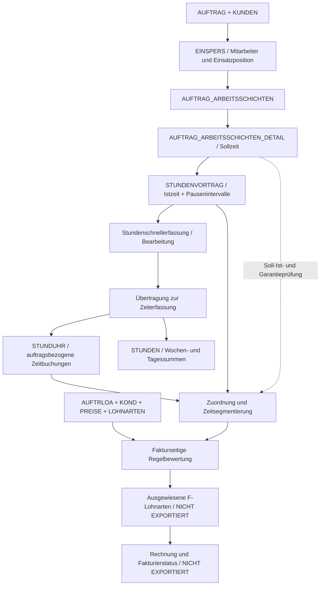

# Systembeschreibung: Zvoove-Auftrags-, Zeiterfassungs- und Fakturierungslogik

**Projekt:** Straight-Monitor / Rekonstruktion der zvoove-L1-Fakturkette  
**Referenzauftrag:** `2510476`  
**Stand:** 16.10.2026  
**Dokumenttyp:** Technische Systembeschreibung / Reverse Engineering / Implementierungsgrundlage  
**Datenbasis:** 16 bereitgestellte Excel-Exporte, `Faktura_Research_Auftrag_2510476(1).pdf`, Auszüge der LANDWEHR/zvoove-PartnerServices-Dokumentation und die beschriebenen Bedienabläufe.

> **Status der Aussagen**  
> **[BELEGT]** = durch Datenfelder bzw. Werte der Exporte nachgewiesen.  
> **[BEOBACHTET]** = in diesem Beispiel nachweisbar bzw. als Arbeitsablauf vom Anwender beschrieben.  
> **[ANNAHME]** = plausible Rekonstruktion, aber nicht gegen zvoove-Fakturpositionen bestätigt.  
> **[OFFEN]** = derzeit fehlende Informationen oder ungeklärte Semantik.

---

## 1. Ziel und Abgrenzung

Dieses Dokument beschreibt das zvoove-System aus Sicht eines einzelnen Auftrags: von der Auftrags- und Schichtplanung über die Stundenmeldung, die Stundenschnellerfassung und die Übertragung in die Zeiterfassung bis zur Ableitung von **fakturierbaren Stunden, Zuschlägen und Rechnungspositionen**.

Ziel ist eine technisch belastbare Grundlage für einen eigenen Faktur-Rechenkern im **Straight-Monitor**. Es handelt sich **nicht** um eine vollständige Spezifikation des zvoove-Quellcodes und **nicht** um den Nachweis, dass sämtliche internen Abrechnungsregeln bereits bekannt sind.

**Zwischenergebnis:** Bei Auftrag `2510476` lassen sich Einsatzzuordnung, Istzeiten, Preise und vier Faktur-Lohnarten pro Mitarbeiter miteinander verknüpfen. Eine plausible **Netto-Modellrechnung von 593,55 EUR** ist möglich. Für die produktive, zvoove-identische Faktur fehlen noch die tatsächlich **ausgewiesenen** F-Lohnarten, der Fakturier-/Rechnungsstatus und bestätigte Regeln für Sonderfälle.

### 1.1 Fachliche Begriffe

| Begriff | Bedeutung in diesem Dokument |
|---|---|
| **Sollzeit** | Geplante Zeit einer Schicht einschließlich ihrer geplanten Zeitfenster. |
| **Istzeit** | Tatsächlich erfasste Arbeitszeit des Mitarbeiters. |
| **Stundenvortrag** | Datensatz mit gemeldeten bzw. in der Schnellerfassung bearbeiteten Istzeiten und detaillierten Pausenfeldern. |
| **Stundenschnellerfassung** | zvoove-Bearbeitungsschritt, der die gemeldeten Zeiten verarbeitet und in diesem beobachteten Ablauf die Werte des Stundenvortrags verändert. |
| **Zeiterfassung** | Nachgelagerte zvoove-Verarbeitung, in der u. a. `STUNDUHR` und `STUNDEN` Einträge vorliegen. |
| **Lohnart** | Regel bzw. Schlüssel für eine abrechnungsrelevante Stunden-, Zuschlags- oder andere Position. |
| **Fakturseite (`VERWENDUNG = 'F'`)** | Kundenabrechnung; von der Lohnseite des Mitarbeiters zu unterscheiden. |
| **Ausgewiesene Fakturlohnart** | Tatsächlich für einen konkreten Zeitraum erzeugte/erfasste Fakturposition; nicht dasselbe wie eine in `AUFTRLOA` hinterlegte Konditionsregel. |
| **Faktur** | Berechnung und Verarbeitung abrechenbarer Leistungen bis zu Rechnungspositionen und Rechnungsstatus. |

---

## 2. Systemüberblick und Datenfluss



**Wichtig:** Das Diagramm verbindet belegte Tabellen und den beschriebenen Bedienprozess mit einer **rekonstruierten** Fakturkette. Die beiden letzten Ebenen sind fachlich notwendig, aber durch die gelieferten Daten **nicht** als konkrete PostgreSQL-Tabellen identifiziert.

### 2.1 Prozessphasen

1. **Auftrag anlegen:** Kunde, Veranstaltung, Einsatzort und Auftragsparameter werden in `AUFTRAG`/`KUNDEN` geführt.
2. **Mitarbeiter einteilen:** `EINSPERS` verbindet Mitarbeiter mit Auftrag, Einsatzortposition, Beruf/Qualifikation und Schicht.
3. **Schicht planen:** `AUFTRAG_ARBEITSSCHICHTEN` hält die Schichtidentität; `AUFTRAG_ARBEITSSCHICHTEN_DETAIL` enthält die geplanten Uhrzeiten und Daten.
4. **Stunden melden:** `STUNDENVORTRAG` enthält Istbeginn, Istende, Iststunden, Pausendauer, bis zu drei konkrete Pausenintervalle und Übertragungs-/Bearbeitungsfelder.
5. **Stunden bearbeiten:** Änderungen in der Stundenschnellerfassung verändern nach dem beschriebenen Arbeitsablauf Werte des Stundenvortrags. Ob frühere Versionen separat historisiert werden, ist **offen**.
6. **Stunden übertragen:** Beim beobachteten Übertragungsprozess liegen passende Datensätze in `STUNDUHR` sowie in `STUNDEN` vor.
7. **Fakturregeln auswerten:** Zeitfenster werden den auftrags- und mitarbeiterbezogenen `AUFTRLOA`-Regeln zugeordnet; `PREISE`, `KOND` und `LOHNARTEN` ergänzen die Preis- und Regeldefinitionen.
8. **Fakturseitige Lohnarten ausweisen:** Nach der zvoove-Prozessbeschreibung ist dies ein zusätzlicher Berechnungs-/Ausweisungsschritt. Sein konkretes Ergebnis fehlt in den Exporten.
9. **Rechnung erzeugen:** Fakturpositionen werden in Rechnungspositionen übernommen und ein Status/Sperrmechanismus verhindert Mehrfachfakturierung. Die zugehörigen konkreten Daten fehlen noch.

---

## 3. Überblick der untersuchten Tabellen und Excel-Exporte

| Excel-Export | Rekonstruierte Tabelle / Inhalt | Rolle im System | Datensätze im Beispiel |
|---|---|---|---:|
| `Auftrag_2510476.xlsx` | `AUFTRAG` | Kopf, Kunde, Auftragsstatus, Veranstaltung | 1 |
| `Kunde_zu_2510476.xlsx` | `KUNDEN` | Kundenstamm | 1 |
| `Einsätze_zu_2510476.xlsx` | `EINSPERS` | Mitarbeiterzuordnung zu Auftrag/Schicht | 4 |
| `Personal_zu_2510476.xlsx` | `PERSONAL` | Mitarbeiterstammdaten | 4 |
| `Schichten_zu_2510476.xlsx` | `AUFTRAG_ARBEITSSCHICHTEN` | Schichtstamm und Einsatzortposition | 4 |
| `Schichtendetail_zu_2510476.xlsx` | `AUFTRAG_ARBEITSSCHICHTEN_DETAIL` | geplante Uhrzeiten, Datum, Bedarf, Pausenplan | 4 |
| `Stundenvortrag_zu_2510476.xlsx` | `STUNDENVORTRAG` | Istzeiten, Pausenintervalle, Übertragung | 4 |
| `Stunduhr_zu_2510476.xlsx` | `STUNDUHR` | konkrete Zeitbuchung mit Auftragsnummer | 4 |
| `Stunden_zu_2510476.xlsx` | `STUNDEN` | Wochen-/Tagesaggregate | 4 |
| `Auftrag_LOA_zu_2510476.xlsx` | `AUFTRLOA` | Fakturlohnarten/Konditionen im Auftrag | 24 |
| `Kond_zu_2510476.xlsx` | `KOND` | allgemeine kundenseitige Konditionsvorlage | 4 |
| `Preise_zu_2510476.xlsx` | `PREISE` | zeitabhängige Kunden-Verrechnungssätze | 10 |
| `Lohnarten full.xlsx` | `LOHNARTEN`-Stammdaten | ausführliche Schlüssel/Flags | 153 |
| `Lohnarten(1).xlsx` | `LOHNARTEN`-Leseliste | zweite Sicht auf Lohnarten | 153 |
| `Berufe_zu_2510476.xlsx` | Berufsstamm | Berufsschlüssel/Bezeichnungen | 22 |
| `Quali_zu_2510476.xlsx` | Qualifikationsstamm | Qualifikationsschlüssel/Bezeichnungen | 120 |

**Granularität beachten:** Die Tabellen enthalten verschiedene Ebenen (Auftrag, Mitarbeiter-Einsatz, Schicht, Schichtdetail, Stundenbuchung, Konditionszeile). Sie können **nicht** unkontrolliert mit einem großen `JOIN` multipliziert und anschließend summiert werden.

---

## 4. Relationen und fachliche Schlüssel

### 4.1 Verknüpfungen für Auftrag und Schicht

| Quelle | Zielfelder | Bedeutung |
|---|---|---|
| `EINSPERS.AUFTRAGNR` | `AUFTRAG.AUFTRAGNR` | Zugehöriger Auftrag |
| `AUFTRAG.KUNDENNR` | `KUNDEN.KUNDENNR` | Zugehöriger Kunde |
| `EINSPERS.PERSONALNR` | `PERSONAL.PERSONALNR` | Zugehöriger Mitarbeiter |
| `EINSPERS.ID_AUFTRAG_ARBEITSSCHICHTEN` | `AUFTRAG_ARBEITSSCHICHTEN.ID` | Zugeordnete Schicht |
| `AUFTRAG_ARBEITSSCHICHTEN_DETAIL.ID_AUFTRAG_ARBEITSSCHICHTEN` | `AUFTRAG_ARBEITSSCHICHTEN.ID` | Detail-Zeitfenster der Schicht |

### 4.2 Verknüpfungen für Zeiterfassung

| Quelle | Zuordnung zum Einsatz |
|---|---|
| `STUNDENVORTRAG` | `IDARBEITSSCHICHT`, `PERSONALNR`, `DATUM` |
| `STUNDUHR` | `IDARBEITSSCHICHT`, `PERSONALNR`, `DATUM`, zusätzlich `AUFTRAGSNR` und `EINSORT` |
| `STUNDEN` | Primär `PERSONALNR`, `JAHR`, `MONAT`, Wochen-/Tagesdimension; die `AUFTRAGNR` ist im Beispiel **nicht** befüllt |

### 4.3 Verknüpfungen für Konditionen

`AUFTRLOA` verwendet insbesondere:

- `AUFTRAGNR`
- `LFDLEISTNR`
- `EINSORTNR`
- `EINSPERSNR`
- `PERSONALNR`
- `VERWENDUNG`
- `LOHNART`

**[BELEGT]** Im Auftrag gibt es auch auftragsbezogene **Vorgabezeilen** mit `EINSPERSNR = 0`, `PERSONALNR = 0`. Diese sind **keine zusätzlichen Mitarbeitereinsätze**. Bei diesem Auftrag existieren acht solche Vorgabezeilen und 16 konkrete Mitarbeiterzeilen.

**Implementierungsregel:** Mitarbeiterzeilen genau dem jeweiligen Mitarbeiter/Einsatz zuordnen. Vorgaben allenfalls als Fallback bzw. Regelvorlage interpretieren und **niemals parallel als abrechenbare Leistungszeilen summieren**. Die endgültige Priorität zwischen Mitarbeiterregel und Vorgabe ist noch durch einen Abweichungstest zu bestätigen.

---

## 5. Schichtplanung und Sollstunden

### 5.1 `AUFTRAG_ARBEITSSCHICHTEN`

Die Schichttabelle stellt den organisatorischen Bezug bereit, unter anderem über:

- `ID` – Schicht-ID;
- `AUFTRAGNR` – Auftragsnummer;
- `EINSORTNR` – Einsatzort-/Einsatzposition;
- `BEZEICHNUNG` – Schichtbezeichnung;
- weitere organisatorische Angaben wie Treffpunkt und Einsatzinformationen.

### 5.2 `AUFTRAG_ARBEITSSCHICHTEN_DETAIL`

Die Detailtabelle beschreibt die **geplanten** Zeitfenster:

- `ID_AUFTRAG_ARBEITSSCHICHTEN`
- `DATUMVON`, `DATUMBIS`
- `UHRZEITVON`, `UHRZEITBIS`
- `TYP`, `BEDARF`
- `GARANTIESTD_LOHN`, `ENDEOFFEN`
- `PAUSEVON`, `PAUSEBIS`

**Unterscheidung:** `PAUSEVON` und `PAUSEBIS` in dieser Tabelle sind Pausenangaben aus der **Schichtplanung**. Sie sind **kein Nachweis**, wann der Mitarbeiter tatsächlich seine Pause genommen hat.

**[BELEGT]** Im Testauftrag enthalten die vier Detaildatensätze zwei Schichten `16:00–20:00` sowie zwei Schichten `23:00–03:00` über Mitternacht. Die eigentlichen Iststunden kommen aus der nachfolgenden Erfassung, nicht aus der Sollplanung.

---

## 6. Stundenvortrag, Stundenschnellerfassung und Zeitbuchung

### 6.1 `STUNDENVORTRAG`: detaillierte Istzeit

Relevante Felder:

| Feld | Bedeutung / beobachtete Rolle |
|---|---|
| `ID` | Datensatzkennung |
| `IDARBEITSSCHICHT` | Zuordnung zur Schicht |
| `PERSONALNR` | Mitarbeiter |
| `DATUM` | Einsatztag |
| `ISTZEITENVON`, `ISTZEITENBIS` | Beginn/Ende der erfassten Arbeit |
| `ISTSTUNDEN` | Erfasste Stundenanzahl |
| `PAUSE` | Gesamtpausenwert |
| `PAUSE1VON` / `PAUSE1BIS` | Zeitfenster der ersten Pause |
| `PAUSE2VON` / `PAUSE2BIS` | Zeitfenster der zweiten Pause |
| `PAUSE3VON` / `PAUSE3BIS` | Zeitfenster der dritten Pause |
| `PAUSE1ISTBEZAHLT` bis `PAUSE3ISTBEZAHLT` | Bezahlstatus je Pause |
| `PAUSEBEZAHLT` | Gesamt-/Statusfeld bezahlter Pausen |
| `PAUSE1VONBEZAHLT` / `PAUSE1BISBEZAHLT` usw. | weitere Zeitangaben zu bezahlten Pausen; genaue Semantik zu validieren |
| `ISTUEBETRAGEN` | Übertragungskennzeichen |
| `UEBERTRAGUNGSDATUM` | Zeitpunkt der Übertragung |
| `BEARBEITUNGABGESCHLOSSEN`, `EDITSTATE` | Bearbeitungsstatus/-kennzeichen |

**[BELEGT]** Diese Tabelle enthält die für die Zuschlagsberechnung wichtigen **Von-bis-Zeitfenster der tatsächlichen Pausen** als eigene Felder. Nur die Summe `PAUSE` zu kennen, wäre unzureichend, um etwa Nachtzuschläge exakt zu berechnen.

**[BEOBACHTET]** Nach der beschriebenen Bedienlogik der Stundenschnellerfassung werden die vorgetragenen Werte im selben Datenbereich bearbeitet. Die Exporte zeigen den Endstand; frühere Werte und Bearbeitungsversionen sind damit noch **nicht** nachgewiesen.

### 6.2 `STUNDUHR`: auftragsbezogene Istbuchung

Für die Faktur wichtige Felder:

- `PERSONALNR`, `AUFTRAGSNR`, `EINSORT`, `DATUM`, `IDARBEITSSCHICHT`;
- `VON`, `BIS`, `STUNDEN`;
- `PAUSE`, `BEZAHLTE_PAUSE`;
- `GUID_ARBEITSZEITEN`, `GUID_PAUSEN` (existieren, sind in diesem Beispiel nicht befüllt).

**[BELEGT]** `STUNDUHR` enthält die auftragsbezogene Zeitbuchung und Pausengesamtwerte, aber **nicht** die drei detaillierten `PAUSEnVON/BIS`-Intervalle aus `STUNDENVORTRAG`.

`STUNDUHR` ist daher eine geeignete führende Quelle für die **gebuchte Einsatzzeit und Auftragszuordnung**, während `STUNDENVORTRAG` die **Pausenintervalle und Erfassungsherkunft** ergänzt. Das endgültige Verhältnis beider Quellen bei nachträglichen Änderungen muss noch getestet werden.

### 6.3 `STUNDEN`: Wochen- und Tagesaggregation

`STUNDEN` enthält unter anderem `T1` bis `T7`, `G1` bis `G7`, `A1` bis `A7`, `E1` bis `E7` und Wochen-/Monatsmerkmale.

**[BELEGT]** Die exportierten vier Zeilen enthalten **keine befüllte `AUFTRAGNR`**. Außerdem stehen in der Wochenmatrix teilweise Stundenwerte, die nicht zu Auftrag `2510476` gehören. Deshalb ist `STUNDEN` **nicht** die richtige Hauptquelle zur Ermittlung auftragsspezifischer Fakturzeiten. Die Tabelle dient vor allem als **zusätzliche Summen- und Plausibilitätskontrolle**.

### 6.4 Übertragungsstatus im Beispiel

Für alle vier Stundenvorträge sind `ISTUEBETRAGEN = 1` und `BEARBEITUNGABGESCHLOSSEN = 1` gesetzt. Das Übertragungsdatum liegt am **13.10.2026**. Passende `STUNDUHR`-Buchungen existieren für die vier Kombinationen aus Personal, Schicht und Einsatztag.

Das belegt im Beispiel den Zusammenhang der Verarbeitung, **nicht** eine revisionssichere Änderungs- oder vollständige Importhistorie.

---

## 7. Pausen: zeitliche Lage ist abrechnungsrelevant

### 7.1 Drei verschiedene Informationsarten

1. **Geplante Pause:** z. B. `AUFTRAG_ARBEITSSCHICHTEN_DETAIL.PAUSEVON/PAUSEBIS` (und Pausenfelder im Einsatzdatensatz).
2. **Tatsächlich erfasste Pause:** `STUNDENVORTRAG.PAUSE1VON/BIS` bis `PAUSE3VON/BIS` sowie ggf. Bezahlkennzeichen.
3. **Aggregierte Pausenmenge:** `STUNDENVORTRAG.PAUSE` bzw. `STUNDUHR.PAUSE`, ohne zwingend die genaue Lage zu liefern.

**Fachliche Vorgabe für den eigenen Rechenkern:** Für Zuschläge die tatsächlichen Pausenintervalle verwenden. Eine bloße Gesamtdauer darf nicht willkürlich vor oder nach die Zuschlagsgrenze gelegt werden.

### 7.2 Beispiel: gleiche Stunden, anderer Zuschlag

Schicht `21:00–01:00`, unbezahlte Pause 30 Minuten, Nachtzuschlag erst ab `23:00`:

| Tatsächliche Pause | Gesamte Arbeitszeit | Nachtarbeitszeit mit Zuschlag |
|---|---:|---:|
| 22:00–22:30 | 3,5 h | 2,0 h |
| 23:00–23:30 | 3,5 h | 1,5 h |

**Folge:** Obwohl die Gesamtdauer identisch ist, verändert allein die Pausenlage die Zuschlagsmenge. Bei 25 % Nachtzuschlag und 30 EUR Verrechnungssatz ergibt das beispielhaft **15,00 EUR** gegenüber **11,25 EUR** Zuschlag. Dieses Beispiel erläutert die Mathematik, nicht eine bestätigte zvoove-Einzelabrechnung.

### 7.3 Bezahlte Pausen

Die Felder für bezahlte Pausen existieren sowohl in der Erfassung (`STUNDENVORTRAG`) als auch teilweise in Zeit- und Konditionsdaten (`STUNDUHR`, `AUFTRLOA`). Sie müssen **getrennt** bewertet werden:

- Zählt eine bezahlte Pause zur **Grundstundenmenge**?
- Zählt dieselbe Pause auch zur **zuschlagspflichtigen Menge**?
- Welche Rolle haben `BEZAHLTE_PAUSE` und `ABZUG_BEZAHLTE_PAUSE` in `AUFTRLOA`?
- Was gilt bei teilweise bezahlter Pause oder mehreren Pausen?

**[OFFEN]** Aus den vier Pausen-freien Beispielschichten lassen sich diese Regeln nicht ableiten. Eine automatische Annahme wie „bezahlte Pause = Zuschläge ja“ wäre nicht gerechtfertigt.

### 7.4 Tatsächliche Pausen im Referenzauftrag

Alle vier Datensätze haben `PAUSE = 0`; `PAUSE1VON` bis `PAUSE3BIS` sind leer. Der Testauftrag **belegt die Existenz der Felder**, liefert aber **keinen positiven Testfall mit eingetragener Pause**.

### 7.5 Validierungsregel

- **0 Pause, keine Intervalle:** konsistent.
- **Pause größer 0, Intervalle vorhanden:** anhand von Datum/Uhrzeit in Arbeitssegmente aufteilen und nach bezahlter/unbezahlter Pause differenzieren.
- **Pause größer 0, Intervalle fehlen:** **Warnung/Prüffall**; Zuschläge bei Überschneidung mit unterschiedlichen Tarifzeitfenstern nicht stillschweigend exakt berechnen.
- **Summe der Pausenintervalle passt nicht zu `PAUSE`:** Konflikt protokollieren und nicht verdecken.
- **Pause außerhalb der Schicht / negative Dauer / überlappende Pausen:** Datensatz invalidieren bzw. explizit prüfen.

---

## 8. Fakturkonditionen, Kundenpreise und Lohnarten

### 8.1 `KOND`: allgemeine Konditionsvorlage

Im Beispiel vier fakturseitige Kunden-Konditionszeilen (`VERWENDUNG = 'F'`) für die Lohnarten **100, 166, 146 und 154**. Bei diesen allgemeinen Vorlagen steht `PREIS = 0`. Das ist **nicht** gleichbedeutend mit einem tatsächlichen Verrechnungssatz von 0 EUR: Die realen auftrags- und personenspezifischen Beträge stehen in `AUFTRLOA` und `PREISE`.

### 8.2 `PREISE`: zeitlich gültige Verrechnungssätze

Kundenseitige Preiszuordnung über insbesondere:

- `KUNDENNR`
- `BERUFSCHL` und `QUALSCHL`
- `DATUMVON`, `DATUMBIS`
- `PREIS1` usw.

Die Auswahl muss nach **Leistungsdatum** und der zutreffenden Berufs-/Qualifikationskombination erfolgen. Im Testauftrag entsprechen die gewählten Sätze in `AUFTRLOA` den zum Einsatzzeitraum passenden `PREISE`-Einträgen.

### 8.3 `AUFTRLOA`: konkrete Fakturregeln

Diese Tabelle ist für die rekonstruierten Fakturregeln besonders wichtig. Relevante Spalten sind:

| Kategorie | Beispiele für Felder |
|---|---|
| Identität/Zuordnung | `AUFTRAGNR`, `EINSORTNR`, `EINSPERSNR`, `PERSONALNR`, `LOHNART`, `VERWENDUNG` |
| Zeitfenster/Wochentage | `AB`, `BIS`, `MONTAG` bis `SONNTAG`, `FEIERTAG` |
| Preis und Zuschläge | `PREISNR`, `PREIS`, `PROZENT` |
| Regelreihenfolge/-typ | `PRIORITAET`, `FOLGELOA`, `NICHTAUTOM`, `ART_LOHNART`, `AUSWAHLDERBERECHNUNG` |
| Schwellwerte/Taktung | `STUNDENGRENZE`, `ABSTUNDENGRENZE`, `ART_STDGRENZE`, `TAKTUNG` |
| Pause | `IGNPAUSE`, `BEZAHLTE_PAUSE`, `ABZUG_BEZAHLTE_PAUSE` |
| Gültigkeit und Sonderfälle | `VONDATUM`, `BISDATUM`, `STARTDATUM`, `ENDEDATUM`, Feiertags-/Vortagsmerkmale |

**Wichtig:** Die Existenz dieser Felder beweist nicht, dass alle Werte-Codes bereits richtig interpretiert werden. Viele Schalter benötigen die Herstellerdefinition oder Vergleichstests.

### 8.4 `LOHNARTEN`: Stammlogik

Die beiden Lohnartenexporte enthalten u. a. Schlüssel und Berechnungsparameter wie `CBERECHNUN`, `CDURCHSPEI` und `ART_STDGRENZE`. Die genaue Auswirkung jedes Codes ist **nicht vollständig bekannt**. Diese Felder müssen vor einer generischen Nachbildung der zvoove-Engine dokumentiert und validiert werden.

### 8.5 Für Auftrag 2510476 gefundene F-Lohnarten

| Lohnart | Interpretation im Test | Zeit-/Tagbedingung | Prozentsatz |
|---|---|---|---:|
| `100` | Normalstunden | 00:00–24:00, alle Tage | 0 % Zusatz |
| `166` | Nachtzuschlag | 23:00–06:00, im Export Fr/Sa aktiv | 25 % |
| `146` | Sonntagszuschlag | Sonntag | 50 % |
| `154` | Feiertagszuschlag | Feiertag | 50 % |

**[ANNAHME]** Die hier berechneten Zuschläge werden auf den jeweiligen `AUFTRLOA.PREIS` angewendet. Die konkreten Ausweisungs-, Vorrang-, Überschneidungs- und Rundungsregeln sind noch gegen zvoove zu prüfen.

---

## 9. Rekonstruiertes Berechnungsverfahren für den Straight-Monitor

Der folgende Ablauf ist eine **empfohlene Zielimplementierung**, nicht bereits identifizierter zvoove-Quellcode.

### 9.1 Eingaben

- Einsatzzuordnung mit Auftrag, Einsatzortposition, Schicht-ID, Mitarbeiter, Beruf, Qualifikation;
- tatsächliche Arbeitsintervalle und Pausenintervalle;
- geplante Sollstunden und ggf. Garantiebedingungen;
- gültige F-Lohnarten einschließlich Zeitfenster-, Wochentags-, Preis- und Schwellenregeln;
- bereits ausgewiesene bzw. fakturierte Positionen und Status (noch zu beschaffen).

### 9.2 Berechnungsschritte

1. **Einsatz identifizieren:** eindeutige Kombination aus Auftrag, Schicht, Einsatzposition, Mitarbeiter und Tag bzw. Buchungs-ID.
2. **Zeit normalisieren:** aus Datum und Uhrzeit echte Start-/Endzeitpunkte bilden; Mitternacht und Zeitzone berücksichtigen.
3. **Pausen auflösen:** tatsächliche Pausenintervalle mit Bezahlstatus zuordnen; Konflikte gesondert markieren.
4. **Zeitsegmente bilden:** Arbeit in Zeitabschnitte zwischen Start, Ende, Pausen, Mitternacht, Wochen-/Feiertagsgrenzen und Konditionswechseln teilen.
5. **Normale Fakturstunden bestimmen:** Grundstundenmenge unter Berücksichtigung der bestätigten Pausen- und Garantieregeln.
6. **Zuschlagsbedingungen pro Segment prüfen:** Zeitfenster, Wochentag, Feiertag, Gültigkeit, weitere Flags und ggf. Grenzen.
7. **Regel-/Preisvorrang anwenden:** individuelle Auftragsregeln gegen Vorgaben und gültige Preisliste auflösen.
8. **Einzelpositionen berechnen:** Menge × Preis oder Zuschlagsbasis × Prozentsatz; Cent-Rundung reproduzierbar definieren.
9. **Mit zvoove-Ausweisung abgleichen:** automatische und manuelle F-Positionen und nachträgliche Korrekturen erkennen.
10. **Nur freigegebene Positionen fakturieren:** Doppelfakturierung verhindern, Historie/Sperren/Stornos speichern.

### 9.3 Zeitsegment-Beispiel

`21:00–01:00` mit Pause `23:00–23:30` wird für die Nachtzuschlagsprüfung bei Grenze `23:00` in folgende **disjunkte** Abschnitte zerlegt:

```text
21:00–23:00   Arbeit, kein Nachtzuschlag
23:00–23:30   Pause, bei unbezahlter Pause keine Nacht-Arbeitsmenge
23:30–00:00   Arbeit, Nachtzuschlag
00:00–01:00   Arbeit, Nachtzuschlag; Folgetag separat prüfen
```

Wichtig sind **echte Zeitpunkte** statt bloßer Uhrzeiten. In Excel können Uhrzeiten als Tagesbruchteile gespeichert sein (beispielsweise `0,958333...` für 23:00). Beim Import müssen Datumsserien und Uhrzeit-Bruchteile sauber konvertiert werden.

### 9.4 Mitternacht, Wochentage und Feiertage

Die Nachtschichten im Test laufen von Freitag `23:00` bis Samstag `03:00`.

- `STUNDUHR.DATUM` bezeichnet im Beispiel den Beginn-Tag, während `VON`/`BIS` Uhrzeitwerte sind.
- `AUFTRAG_ARBEITSSCHICHTEN_DETAIL` führt dagegen **separate** `DATUMVON`/`DATUMBIS`.
- Für die Berechnung darf `03:00` daher **nicht** als frühere Uhrzeit desselben Kalendertags interpretiert werden.
- Wochentags-/Feiertagsflags müssen für die jeweiligen Zeitsegmente geprüft werden. **Offen** ist, wann zvoove Regeln anhand des Schichtbeginn-Tages oder des tatsächlichen Segmenttages auslegt; das kann für Zuschläge über Mitternacht entscheidend sein.
- Bei Sommer-/Winterzeitwechsel ist eine lokale Uhrzeit ohne Zeitzonen- oder Offsetinformation unter Umständen **mehrdeutig**. Nicht einfach pauschal vier Stunden aus der Uhrzeitdifferenz ableiten.

### 9.5 Korrektheitsanforderungen

- **Minutenbasierte Zeitrechnung**, keine voreilige Rundung von Uhrzeiten auf Viertelstunden.
- **Dezimalrechnung für Geld**, keine unkontrollierten Floating-Point-Beträge.
- **Definierte Rundungsregeln** pro Position/Tag/Monat; Herstellerabgleich nötig.
- **Keine Doppelzählung** bei mehreren Regeln, Schichtdetails oder mitarbeiterlosen Vorgaben.
- **Regelversion und Preisgültigkeit** je Leistungsdatum speichern.
- **Rechenherkunft je Position** mit Ursprungs-IDs nachweisen.

---

## 10. Konkreter Auftrag 2510476: Befunde und Modellrechnung

**[BELEGT]** Am Freitag, **09.10.2026**, gibt es vier zugeordnete Mitarbeiter-Einsätze, vier Schichten, vier Schichtdetails, vier Stundenvorträge und vier zugehörige `STUNDUHR`-Zeilen. In diesem Auftrag liegen alle erfassten Pausenwerte bei 0.

| Personalnr. | Schicht | Iststunden | Verrechnungssatz | Grundbetrag | Modell-Nachtzuschlag | Gesamt |
|---|---|---:|---:|---:|---:|---:|
| `2001090` | 16:00–20:00 | 4 h | 35,00 EUR/h | 140,00 EUR | 0,00 EUR | **140,00 EUR** |
| `2001170` | 16:00–20:00 | 4 h | 30,95 EUR/h | 123,80 EUR | 0,00 EUR | **123,80 EUR** |
| `2001193` | 23:00–03:00 | 4 h | 35,00 EUR/h | 140,00 EUR | 35,00 EUR | **175,00 EUR** |
| `2001120` | 23:00–03:00 | 4 h | 30,95 EUR/h | 123,80 EUR | 30,95 EUR | **154,75 EUR** |
| **Summe** | | **16 h** | | **527,60 EUR** | **65,95 EUR** | **593,55 EUR** |

Die Musterrechnung verwendet **16 Stunden Grundvergütung** plus **acht Nachtzuschlagsstunden** zu 25 %. Der Zuschlag ist eine **zusätzliche Betragsposition**, die acht Stunden sind **nicht** als acht weitere geleistete Arbeitsstunden zu interpretieren.

**Keine bestätigte Rechnung:** `593,55 EUR` ist ein nachgerechneter Netto-Modellbetrag **vor weiteren denkbaren Positionen und Umsatzsteuer**. Die tatsächlich von zvoove ausgewiesene Faktur und die endgültige Rechnung wurden mit diesen Quellen **nicht** abgeglichen.

---

## 11. Welche Ebene fehlt noch zur echten Faktur?

### 11.1 Eingestellte vs. ausgewiesene Lohnarten

`AUFTRLOA` beschreibt, **welche Lohnart unter welchen Bedingungen** für Auftrag und Mitarbeiter eingestellt ist. Das bedeutet noch nicht, dass die zugehörige konkrete Fakturmenge, das Datum und der endgültige Betrag bereits als Position existieren.

Die bereitgestellte Research-Dokumentation verweist auf zvoove-Hinweise zum **Ausweisen von Lohnarten** nach Übernahme der Stunden. Sie beschreibt zudem, dass **manuelle F-Lohnarten** getrennt behandelt werden können.

**[OFFEN]** Die Speicherung der tatsächlich ausgewiesenen Positionen im konkreten PostgreSQL-Schema wurde nicht gefunden. Die vollständige Nachbildung muss unter anderem folgende Zustände unterscheiden:

- automatisch ermittelte F-Lohnart;
- manuell ergänzte/geänderte F-Lohnart;
- erneut ausgewiesene/nachberechnete Position;
- bereits abgerechnete und für Änderungen gesperrte Leistung;
- Korrektur, Storno oder Gutschrift.

### 11.2 Rechnungsdaten

Folgende Informationen wurden in den 16 Exporten nicht vollständig nachgewiesen:

- eindeutige Rechnungspositionen und Rechnungsnummern;
- Beziehung **Zeitbuchung → ausgewiesene Fakturposition → Rechnung**;
- Rechnungslauf, Fakturierstatus, Sperre und Idempotenz;
- Adressdaten des Rechnungsempfängers;
- finale Steuer-/Belegregeln, Gutschriften, Stornos;
- verbindliche Rundung, Garantie, Mindestmenge, bezahlte Pause, Zuschlagspriorität.

**Nicht nachgewiesen** heißt **nicht zwangsläufig**, dass die Daten in zvoove fehlen. Es heißt nur, dass sie **nicht Teil dieser Exporte** sind. Interne Tabellenbezeichnungen dürfen nicht geraten werden.

---

## 12. Ergänzender Weg über das LANDWEHR/zvoove-Partnernetzwerk

Die bereitgestellte Datei `PartnerServices-merged.pdf` dokumentiert den `L1StundenerfassungXmlService` mit einem GET-Endpunkt für Arbeitszeiten:

```text
/L1StundenerfassungXmlService/api/v1/Stunden/Arbeitszeiten
```

Als Requestparameter werden `Abrechnungsmonat`, `Abrechnungsjahr` sowie optional `Personalnummer` beschrieben. Das XML-Format bietet pro Arbeitszeit u. a. Datum und Gesamtstunden sowie **Arbeitszeitendetails** mit:

- `UhrzeitVon` und `UhrzeitBis`;
- `Stunden`;
- `Pause` (`J`/`N`);
- `Kundennummer`, `Auftragsnummer`, `Einsatzortnummer` und `Einsatzortbezeichnung`.

Damit ist die Schnittstelle ein möglicher **zusätzlicher Validierungsweg** für Arbeits-/Pausenabschnitte. **[OFFEN]** Ob eure Installation hierfür berechtigt/freigeschaltet ist, die Abfrage erreichbar ist und die nötige Historie vollständig liefert. Die Dokumentation beweist auch **keine** Verfügbarkeit bereits ausgewiesener F-Lohnarten über diesen Endpoint.

---

## 13. Empfohlenes Zielmodell für Straight-Monitor

Die importierten Tabellen sollten **nicht** 1:1 zu einer undurchsichtigen Faktur-Collection zusammengeführt werden. Empfehlenswert ist eine Trennung in:

| Technische Schicht | Aufgabe |
|---|---|
| **Raw Import** | Originaldatensätze unverändert mit Tabelle, Quell-ID, Importzeit, Datenbank/Mandant speichern. |
| **Relation/Normalization** | Auftrag, Einsatz, Mitarbeiter, Schicht, Istbuchung und Pausen über belegte Schlüssel zusammenführen. |
| **Time Segments** | Vollständige Datums-Zeitintervalle und Pausenstatus normalisieren; an Tarif-/Tagesgrenzen schneiden. |
| **Rule Resolution** | Gültige F-Lohnarten, Mitarbeiter-Vorrang, Preis, Zuschlagsbedingungen und Gültigkeit bestimmen. |
| **Calculation Engine** | Mengen, Beträge und Rundungen deterministisch berechnen. |
| **Reconciliation** | Eigenberechnung gegen echte zvoove-Fakturausweisung/Rechnungen vergleichen. |
| **Billing Ledger** | Freigabe, Fakturierstatus, Storno, Korrektur, Versionsstand und Doppelfakturierung verwalten. |

### 13.1 Beispiel einer normalisierten Zeitbuchung

*Konzeptionelles Zielschema – keine Original-PostgreSQL-Tabelle:*

```json
{
  "source": {
    "system": "zvoove_l1",
    "table": "STUNDUHR",
    "source_record_key": "person+assignment+date+booking",
    "stundenvortrag_id": 2166547
  },
  "assignment": {
    "auftragNr": 2510476,
    "personalNr": 2001193,
    "einsortNr": 1,
    "schichtId": 1100922
  },
  "actualTime": {
    "startLocal": "2026-10-09T23:00:00",
    "endLocal": "2026-10-10T03:00:00",
    "timeZone": "Europe/Berlin",
    "reportedHours": "4.00",
    "breaks": []
  },
  "billing": {
    "status": "unreconciled",
    "rulesVersion": null,
    "invoiceId": null
  }
}
```

Die zusammengesetzte `source_record_key` ist hier **nur eine konzeptionelle Identifikation**, kein nachgewiesener eindeutiger Schlüssel. Vor Implementierung muss geprüft werden, ob Buchungsnummer, `LFDNR`, `REPL_ID`, `GUID_ARBEITSZEITEN` oder eine andere stabile ID für alle relevanten Fälle zuverlässig ist.

### 13.2 Grundsätze

- **Zvoove-Originaldaten nicht überschreiben**; nachträgliche Änderungen versioniert als neue Import-Snapshots erfassen.
- **Berechnung und Rechnung trennen:** Ein berechneter Vorschlagsbetrag ist nicht automatisch eine fakturierte Forderung.
- **Begründbare Ergebnisse:** jede Position braucht Auftrags-/Mitarbeiter-/Schichtbezug, Zeitsegmente, verwendete Lohnart, Preis, Regelversion, Ausgangszeilen und Rechenweg.
- **Mitarbeiterdaten minimieren:** Der Fakturkern benötigt normalerweise IDs/Qualifikationen, nicht unnötig sämtliche Personalstammdaten.
- **Fehler sichtbar machen:** Fehlende Pausenzeit, widersprüchliche Preise oder doppelte Buchungen als prüfpflichtige Datenprobleme ausweisen.

---

## 14. Offene Fragen und priorisierte Validierung

| Priorität | Thema | Zu klärender Nachweis / Test |
|---|---|---|
| **KRITISCH** | Tatsächlich ausgewiesene F-Lohnarten | Echte Fakturvorschau je Mitarbeiter/Datum/Lohnart/Menge/Betrag beschaffen und Speicherort identifizieren. |
| **KRITISCH** | Fakturierstatus | Nachweisen, wann Stunden gesperrt/fakturiert werden und wie Rechnungsläufe, Stornos und Korrekturen gespeichert sind. |
| **HOCH** | Pausenlage nach Übertragung | Echten Auftrag mit `PAUSE1VON/BIS` und ggf. weiteren Pausen exportieren; Status vor/nach Übertragung vergleichen. |
| **HOCH** | Bezahlte Pausen | Unterschiedliche `PAUSE...ISTBEZAHLT`- und Konditionskonfigurationen gegen echte Ausweisung prüfen. |
| **HOCH** | Lohnartencodes | `CBERECHNUN`, `CDURCHSPEI`, `ART_STDGRENZE`, `PRIORITAET`, `TAKTUNG` etc. fachlich auflösen. |
| **HOCH** | Wochentag über Mitternacht | Klären, ob Fr/Sa/Sonntag/Feiertag auf tatsächlichen Segmenttag oder Schichtbeginn bezogen werden. |
| **HOCH** | Zuschlagsüberschneidung | Kombinierbarkeit/Vorrang von Nacht-, Sonntag-, Feiertags- und Sonderzuschlag prüfen. |
| **HOCH** | Mindest-/Garantieleistungen | Garantierte Stunden und abweichende Iststunden an mindestens einem echten Fall testen. |
| **HOCH** | Preisgültigkeit/-vorrang | Änderungen während des Auftrags, individuell abweichende Sätze und mehrere zutreffende Preiszeilen testen. |
| **HOCH** | Rundung | zvoove gegen minuten-, tages-, positions- und rechnungsweise Berechnung abgleichen. |
| **MITTEL** | Mehrfachbuchungen/-details | Mehrere `STUNDUHR`-Zeilen und mehrere Schichtdetailzeilen pro Schicht testen. |
| **MITTEL** | Rechnungsstamm | Rechnungsadresse, Steuerschlüssel, Währung und Empfängerdaten vervollständigen. |

### 14.1 Technische Abnahmetests

Ein robuster Satz echter Vergleichsaufträge sollte mindestens diese Fälle enthalten:

1. Tagschicht ohne Pause, ohne Zuschlag.
2. Nachtschicht über Mitternacht, ohne Pause.
3. Pause vollständig **vor** der Nachtgrenze.
4. Pause vollständig **innerhalb** des Nachtfensters.
5. Bezahlte Pause im Nachtfenster.
6. Mehrere Pausen bzw. pauschale Pause ohne Von-bis-Information.
7. Freitagnacht auf Samstag und Samstagnacht auf Sonntag.
8. Schicht über Feiertagswechsel.
9. Sonntag und Feiertag gleichzeitig, mit möglicher Zuschlagskollision.
10. Garantierte Mindeststunden trotz kürzerer Istzeit.
11. Individuelle Preisabweichung und geänderter Preis-Gültigkeitszeitraum.
12. Manuelle F-Lohnart und erneute automatische Ausweisung.
13. Korrektur nach Übertragung und nach bereits gestarteter Faktur.
14. Mehrere Zeitbuchungen einer Person auf demselben Auftrag/Tag.
15. Doppelt angestoßener Fakturlauf, anschließend Storno/Gutschrift.

**Abnahmekriterium:** Alle Einzelmengen und Einzelbeträge werden zu echten zvoove-Fakturpositionen zurückverfolgt; Differenzen werden erklärt, nicht bloß durch Rundung auf die Endsumme versteckt. Für eine produktive Freigabe sollten mindestens 10–20 bewusst unterschiedliche reale Aufträge geprüft werden.

---

## 15. Gesamtbewertung

**Was für den Prototyp belegt ist:**

- Auftrag, Kunde, Mitarbeiter, Einsatz-/Schichtzuordnung und Sollstunden lassen sich verknüpfen.
- `STUNDENVORTRAG` enthält erfasste Arbeitszeiten und **detaillierte Pausen-Von-bis-Felder**.
- `STUNDUHR` enthält auftragsbezogene Istzeitbuchungen mit Pausensummen.
- `STUNDEN` bildet eine zusätzliche Wochen-/Tagessumme, ist aber hier **nicht** zuverlässig auftragsscharf.
- `AUFTRLOA`, `KOND`, `PREISE` und `LOHNARTEN` liefern wesentliche kundenseitige Preis- und Konditionsinformationen.
- Die bekannte Musterrechnung für den Auftrag ist nachvollziehbar: **593,55 EUR netto als Modell, nicht als bestätigte Rechnung**.

**Was noch nicht bewiesen ist:** Die vollständige Ausweisungslogik der F-Lohnarten, alle Code-/Schwellenregeln, Prioritäten bei Zuschlagsüberschneidungen, bezahlte Pausen, manuelle Korrekturen und der verbindliche Rechnungslebenszyklus.

**Architekturentscheidung:** Einen eigenständigen **deterministischen Rechenkern** für die bekannte Menge an Stunden- und Zuschlagsregeln zu bauen, ist technisch realistisch. Ihn ohne Abgleich mit ausgewiesenen Fakturpositionen direkt als produktive zvoove-Ablösung einzusetzen, wäre fachlich riskant. Der nächste entscheidende Schritt ist nicht ein weiterer ungezielter Stammdatenexport, sondern ein **1:1-Abgleich der Lohnart-Ausweisung und Rechnungsvorschau** sowie ein **echter Pausen-Testfall**.

---

## 16. Quellen, Beleggrenzen und Dokumentpflege

### Primärmaterial

- `Auftrag_2510476.xlsx`
- `Kunde_zu_2510476.xlsx`
- `Einsätze_zu_2510476.xlsx`
- `Personal_zu_2510476.xlsx`
- `Schichten_zu_2510476.xlsx`
- `Schichtendetail_zu_2510476.xlsx`
- `Stundenvortrag_zu_2510476.xlsx`
- `Stunduhr_zu_2510476.xlsx`
- `Stunden_zu_2510476.xlsx`
- `Auftrag_LOA_zu_2510476.xlsx`
- `Kond_zu_2510476.xlsx`
- `Preise_zu_2510476.xlsx`
- `Lohnarten full.xlsx`, `Lohnarten(1).xlsx`
- `Berufe_zu_2510476.xlsx`, `Quali_zu_2510476.xlsx`
- `Faktura_Research_Auftrag_2510476(1).pdf` – zusammenfassender Ausgangs-Research mit Musterberechnung und dort referenzierten zvoove-Wissensartikeln.
- `PartnerServices-merged.pdf` – LANDWEHR/zvoove-Partnernetzwerk, Abschnitt `L1StundenerfassungXml`.

### Ergänzende Dokumentationslinks aus dem ursprünglichen Research

- [Lohnarten in der Stundenerfassung berechnen bzw. ausweisen](https://go.zvoove.com/knowledge/lohnarten-in-der-stundenerfassung-berechnen-bzw-ausweisen)
- [Warum keine Lohnarten nach der Übernahme sichtbar sind](https://go.zvoove.com/knowledge/wieso-kann-ich-in-der-stundenerfassung-keine-lohnarten-sehen-wenn-ich-meine-stunden-aus-der-zeiterfassung-bzw.-der-stundenschnellerfassung-%C3%BCbernommen-habe)
- [Lohnarten manuell in der Stundenerfassung hinterlegen](https://go.zvoove.com/knowledge/habe-ich-die-moeglichkeit-ueber-neu/aendern-in-der-stundenerfassung-auch-lohnarten-auf-der-seite-der-schattenabrechnung-einzufuegen)
- [Fakturierung in zvoove – Schritt für Schritt](https://go.zvoove.com/knowledge/fakturierung-in-zvoove-durchfuehren-schritt-fuer-schritt-anleitung)

Die externen Links wurden für **diese Fassung** nicht erneut live überprüft; die Aussagen dazu beruhen auf dem bereitgestellten Research-Bericht und der darin dokumentierten Quellenlage.

### Änderungsvermerk

- **16.10.2026:** Erste eigenständige Systembeschreibung auf Basis der 16 Tabellenexporte und des vorherigen Research-Berichts; detaillierte Unterscheidung von geplanten/tatsächlichen Pausen und Ausweisung der Datenlücken für die Fakturierung.
